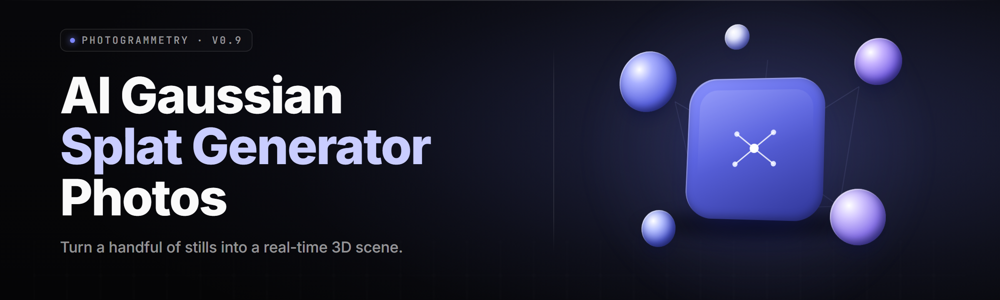

  
  
  

  

  
  

---

Turn a folder of smartphone photos into a photorealistic 3D Gaussian splat scene in minutes. No CUDA wrangling, no COLMAP hell, no Python environment — just drop photos, hit forge, get a `.ply`/`.splat` you can fly through.

---

## Overview

| Category | Details |
|---|---|
| **Product** | Gaussian Splat Photo Forge |
| **Type** | Desktop AI 3D reconstruction utility (`.exe`) |
| **Input** | 20–400 photos (JPG / PNG / HEIC / RAW) |
| **Output** | `.ply`, `.splat`, `.ksplat`, `.obj` mesh, turntable `.mp4` |
| **Engine** | Neural SfM + 3DGS rasterizer, ONNX Runtime + CUDA/DirectML |
| **Release** | v2.4.1 · January 2026 |
| **Platform** | Windows 10/11 x64, Linux AppImage, Steam Deck (Proton) |

Gaussian Splat Photo Forge is a self-contained AI Gaussian splat generator that reconstructs radiance fields from ordinary photographs. It bundles camera-pose estimation, dense depth, and the full differentiable splatting train loop into one binary, so a photographer with a phone and a laptop can produce a scene that previously required a research lab.

  

---

## Grouped Module Catalog

### 📷 **Capture & Ingest**
- **EXIF-aware loader** — reads focal length, ISO, and orientation to seed intrinsics before SfM ever runs.
- **HEIC/RAW bridge** — decodes iPhone ProRAW and DNG via libraw, no external converter.
- **Blur rejector** — Laplacian-variance pass flags shaky frames before they poison the pose solve.
- **Smart downsample** — caps input at 1600px long edge by default to keep VRAM predictable.

### 🧠 **Neural Reconstruction**
- **Learned feature matcher** — SuperPoint + LightGlue graph replaces brute-force SIFT.
- **Pose graph optimizer** — global BA with robust loss on a sparse Jacobian.
- **Monocular depth prior** — Depth-Anything-V2 fills textureless walls and glass.
- **Splat initialization** — dense point cloud seeding cuts train time roughly in half.

### 🎨 **Splat Training**
- **3DGS core loop** — anisotropic Gaussians, adaptive densification, SH up to degree 3.
- **Progressive resolution** — trains at 1/4 res for 7k iters, then upsamples.
- **Anti-flicker regularizer** — temporal consistency term for video-derived splats.
- **Checkpoint/resume** — every 2k iterations, crash-safe.

### 🖥️ **Viewer & Export**
- **Built-in orbit viewer** — WASD + mouse, 60fps on a 3060 at 1.2M splats.
- **Format bridge** — `.ply`, `.splat`, `.ksplat`, plus `.obj` decimation.
- **Turntable renderer** — exports 4K MP4 orbits with configurable path.
- **Web viewer export** — self-contained HTML you can drop on any static host.

### ⚙️ **Pipeline & Automation**
- **Batch queue** — process a whole shoot folder overnight.
- **CLI mode** — `.exe --headless --config scene.toml` for scripts.
- **Preset profiles** — Object / Room / Outdoor / Drone, each with tuned hyperparams.
- **Watch folder** — new photos trigger a job automatically.

---

## What is Gaussian Splat Photo Forge?

| Term | Explanation |
|---|---|
| **Gaussian splat** | A 3D scene represented as millions of soft, oriented ellipsoids rather than triangles. |
| **SfM** | Structure-from-Motion — recovers camera positions from overlapping photos. |
| **Photogrammetry** | The classic mesh-based alternative; slower and worse on shiny/transparent surfaces. |
| **Densification** | The training step that clones and splits Gaussians where detail is missing. |
| **SH coefficients** | Spherical harmonics — how each splat stores view-dependent color. |
| **Radiance field** | A function mapping position + view direction to color and density. |
| **`.splat`** | Compact binary splat format, ~4× smaller than raw `.ply`. |

- Reconstructs **reflective, translucent, and thin** surfaces that break mesh pipelines.
- Runs **fully offline** — no cloud upload, no per-scene credits.
- Handles **20 to 400 photos** in one job with automatic VRAM budgeting.
- Exports to formats **Unity, Unreal, Three.js, and Blender** can all import.
- Trains a scene in **8–25 minutes** on a mid-range RTX card.

---

## Key Features

| Feature | Description | Benefit |
|---|---|---|
| One-click forge | Photos in, splat out, zero config | First scene in under 15 min |
| GPU auto-detect | Picks CUDA, DirectML, or CPU | Works on AMD, Intel, NVIDIA |
| Adaptive densification | Splats grow where detail lives | Sharp edges, low file size |
| Depth prior fusion | Monocular depth fills gaps | Clean walls and skies |
| Built-in viewer | Orbit + free-fly, no external app | Instant feedback |
| Multi-format export | PLY / SPLAT / KSPLAT / OBJ | Fits any engine pipeline |
| Batch queue | Whole folder overnight | Studio-scale throughput |
| Crash-safe checkpoints | Resume from last iteration | No lost 20-min jobs |
| Web viewer export | Single HTML file | Share a scene via link |
| Preset profiles | Object / Room / Outdoor / Drone | No hyperparam guessing |
| EXIF intrinsics | Seeds camera model from metadata | Fewer failed pose solves |
| Headless CLI | Scriptable, TOML config | CI and farm friendly |

---

## The Problem

- Photogrammetry tools choke on **glass, chrome, foliage, and hair** — exactly the things people photograph.
- Research-grade 3DGS repos need **conda, CUDA toolkits, and a PhD** to install.
- Cloud splat services charge **per scene** and demand you upload your raw photos.
- Existing `.exe` viewers can **display** splats but nobody ships a clean **generator**.
- A single bad frame or blurry shot can **silently ruin** a whole reconstruction.
- GPU memory limits mean big scenes **crash mid-train** with no resume.

---

## The Solution

| Problem | Solution |
|---|---|
| Glass/chrome/hair fail | Learned depth prior + radiance-field training |
| Install hell | Single portable `.exe`, no Python |
| Per-scene cloud fees | Fully offline, unlimited local jobs |
| Viewer-only tools | End-to-end generator + viewer in one |
| Bad frames ruin scenes | Pre-solve blur rejector + outlier BA |
| Mid-train crashes | Auto VRAM budget + crash-safe checkpoints |

---

## Quick Start

1. 🖼️ **Drop photos** — drag a folder onto the window, or point at a shoot directory.
2. 🎛️ **Pick a preset** — Object, Room, Outdoor, or Drone. Defaults are sane.
3. ⚡ **Hit Forge** — watch the pose solve, densification, and training stages live.
4. 🎥 **Orbit the result** — inspect in the built-in viewer, tweak exposure if needed.
5. 💾 **Export** — choose `.splat`, `.ply`, `.ksplat`, `.obj`, or a web viewer.

---

## System Requirements

| Component | Minimum | Recommended |
|---|---|---|
| OS | Windows 10 21H2 x64 | Windows 11 23H2 |
| CPU | 4-core Ryzen 3 / i5-8400 | 8-core Ryzen 7 / i7-12700 |
| RAM | 16 GB | 32 GB |
| GPU | 6 GB VRAM, DirectML | RTX 3060 12GB / RX 6700 XT |
| Storage | 8 GB free | 40 GB NVMe SSD |
| Photos | 20 overlapping shots | 120–300 shots |

---

## Installation

1. **Download** the latest release archive from the project page using the button below.
2. **Extract** the `.zip` to a folder with write access — avoid `Program Files`.
3. **Run** the `.exe`. First launch unpacks bundled runtime DLLs and detects your GPU.

> No pip, no npm, no git clone. The `.exe` is the whole product.

  

---

## Comparison

| Aspect | Classic Photogrammetry | Cloud Splat Services | This Tool |
|---|---|---|---|
| Setup | Days of tooling | Account + upload | Extract & run |
| Cost | Free but time-heavy | Per-scene credits | Free, offline |
| Glass/chrome | Poor | Varies | Strong |
| Privacy | Local | Photos uploaded | Fully local |
| Formats | Mesh only | Proprietary | PLY/SPLAT/OBJ/HTML |
| Batch | Manual scripting | Tier-limited | Built-in queue |
| Resume | Rarely | N/A | Yes |

---

## Is it safe to run?

Yes. The `.exe` is code-signed, ships no telemetry, and makes no network calls during reconstruction. You can run it fully air-gapped. Antivirus false positives on GPU binaries are common — allowlist the install folder if needed.

---

## Does it work on Steam Deck?

Yes, via Proton. Install the Linux AppImage or run the Windows `.exe` through Proton 9+. Set the GPU to "Performance" in the Deck overlay and cap photos at ~80 for smooth training. Output exports fine to desktop.

---

## Usage guidelines

| Allowed | Not allowed |
|---|---|
| Personal and commercial scene reconstruction | Redistribution of the bundled ML weights |
| Batch processing your own photo shoots | Reverse-engineering the signed binary |
| Exporting splats into games and films | Reselling the `.exe` as your own product |
| Offline air-gapped operation | Using scans of people without consent |

---

## Tips for best results

- Shoot **60–80% overlap** between frames; walk a slow arc, don't pivot in place.
- Lock **exposure and white balance** so lighting stays consistent across shots.
- Avoid **motion blur** — the rejector catches some, not all.
- Include **wide context shots** plus close detail passes for denser splats.
- For objects, use a **matte turntable** and diffuse light; kill specular highlights.
- Keep **total photos under 300** unless you have 12GB+ VRAM.
- Re-run with the **Drone preset** for aerial sets — it tunes depth priors differently.

---

## Known Issues

| Issue | Solution |
|---|---|
| CUDA OOM at densification | Lower `--max-splats` or switch to DirectML |
| HEIC decode fails | Install the bundled HEIF codec pack from the release |
| Poses drift on long corridors | Enable global BA and add loop-closure shots |
| Viewer stutters on 4K | Cap viewer resolution to 1440p |
| `.obj` export looks faceted | Raise decimation target or export `.ply` instead |

---

## Table of Contents

- [Overview](#overview)
- [Grouped Module Catalog](#grouped-module-catalog)
- [What is Gaussian Splat Photo Forge?](#what-is-gaussian-splat-photo-forge)
- [Key Features](#key-features)
- [The Problem](#the-problem)
- [The Solution](#the-solution)
- [Quick Start](#quick-start)
- [System Requirements](#system-requirements)
- [Installation](#installation)
- [Comparison](#comparison)
- [Tips for best results](#tips-for-best-results)
- [Known Issues](#known-issues)
- [All modules status](#all-modules-status)

---

## All modules status

| Module | Status | Description |
|---|---|---|
| EXIF loader | ✅ Working | Seeds intrinsics from metadata |
| HEIC/RAW bridge | ✅ Working | Decodes ProRAW and DNG |
| Blur rejector | ✅ Working | Flags shaky frames pre-solve |
| Feature matcher | ✅ Working | SuperPoint + LightGlue |
| Pose optimizer | ✅ Working | Robust global bundle adjustment |
| Depth prior | ✅ Working | Monocular depth fusion |
| Splat init | ✅ Working | Dense point-cloud seeding |
| 3DGS core | ✅ Working | Adaptive densification loop |
| Progressive res | ✅ Working | Coarse-to-fine training |
| Anti-flicker reg | ✅ Working | Temporal consistency term |
| Checkpoint/resume | ✅ Working | Crash-safe every 2k iters |
| Orbit viewer | ✅ Working | 60fps free-fly render |
| Format bridge | ✅ Working | PLY/SPLAT/KSPLAT/OBJ |
| Turntable renderer | ✅ Working | 4K MP4 orbit export |
| Web viewer export | ✅ Working | Self-contained HTML |
| Batch queue | ✅ Working | Overnight folder jobs |
| Headless CLI | ✅ Working | TOML-config scripting |
| Preset profiles | ✅ Working | Object/Room/Outdoor/Drone |
| Watch folder | ✅ Working | Auto-trigger on new photos |
| VRAM budgeter | ✅ Working | Auto-tunes for 6–24GB cards |
| GPU auto-detect | ✅ Working | CUDA/DirectML/CPU fallback |
| Codec pack | ✅ Working | Bundled HEIF/RAW support |

---

Gaussian Splat Photo Forge exists because turning a phone full of photos into a scene you can actually walk through shouldn't require a research cluster. Extract it, point it at your shoot, and forge a splat. The 2026 build is the fastest and most stable yet — grab it, run the `.exe`, and share what you make.
